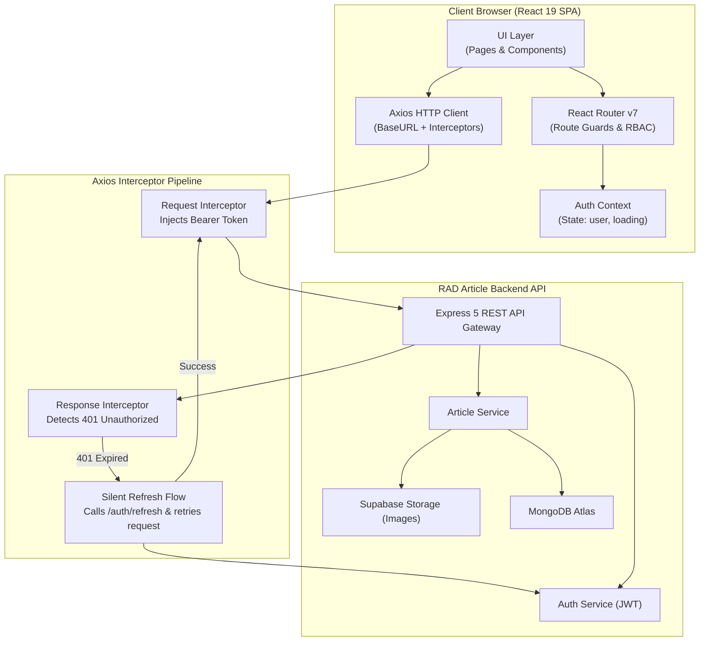
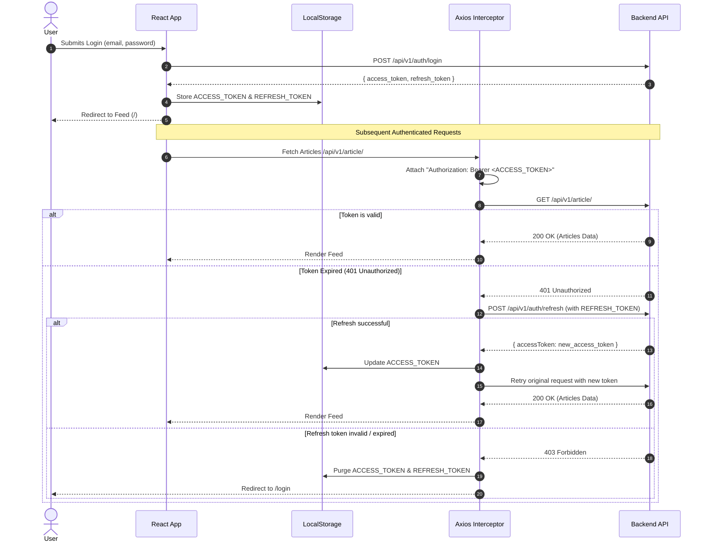

<div align="center">

# 📰 RAD Article Web — Frontend Portal

**A Modern, High-Performance Content Publishing & Community Reading Platform built with React 19, TypeScript, Vite, and Tailwind CSS v4.**

[](https://react.dev/)
[](https://www.typescriptlang.org/)
[](https://vitejs.dev/)
[](https://tailwindcss.com/)
[](https://reactrouter.com/)
[](https://axios-http.com/)
[](LICENSE)

[View Live Backend API](https://rad-article-be.vercel.app/api/v1/) • [Backend Repository](https://github.com/chathunga2007/ITS2020-RAD-Article-Backend) • [Report Bug](https://github.com/chathunga2007/ITS2020-RAD-Article-Frontend/issues)

</div>

---

## 📑 Table of Contents

- [Overview](#-overview)
- [Key Features](#-key-features)
- [System Architecture](#-system-architecture)
- [Technology Stack](#-technology-stack)
- [Project Directory Structure](#-project-directory-structure)
- [Routing & Access Control](#-routing--access-control)
- [Authentication & Token Rotation Lifecycle](#-authentication--token-rotation-lifecycle)
- [Getting Started](#-getting-started)
  - [Prerequisites](#prerequisites)
  - [Installation](#installation)
  - [Environment Configuration](#environment-configuration)
  - [Development Server](#development-server)
  - [Production Build](#production-build)
- [API Integration](#-api-integration)
- [Design & User Experience](#-design--user-experience)
- [Contributing](#-contributing)
- [License](#-license)

---

## 🌟 Overview

**RAD Article Web** is the frontend client for the **RAD Article Publishing Ecosystem**, crafted for speed, user engagement, and clean typography. The platform empowers developers, tech writers, and learners to publish rich articles with cover images, categorize posts with dynamic tags, browse through paginated feeds, and authenticate securely using JWT session management.

Built on the latest cutting-edge web stack (**React 19**, **Vite 8**, and **Tailwind CSS v4**), it features an ultra-responsive UI, instant hot-module replacement (HMR), seamless token rotation interceptors, and strict TypeScript typing.

---

## ✨ Key Features

- **🔐 Dual-Token JWT Authentication**:
  - Secure login and registration with validation feedback.
  - Persistent authentication state via `AuthContext` with automatic user profile hydration.
  - Transparent silent token renewal using Axios interceptors upon receiving HTTP 401.

- **🛡️ Role-Based Route Protection**:
  - Centralized `<RequireAuth>` route guard preventing unauthorized access.
  - Role-specific access control supporting `ADMIN`, `WRITER`, and `USER` privileges.

- **📰 Interactive Community Feed**:
  - Paginated article exploration (`getAllArticles(page, limit)`).
  - Real-time client-side search across article titles and body content.
  - Dynamic filter pills generated from active tags across the article database.

- **✍️ Dual Publishing Workflows**:
  - **Full Creation Studio** (`/create-article`): Comprehensive editor with multi-tag support and image preview.
  - **⚡ Quick Post on Home**: Instant accordion drawer on the home feed for rapid publishing without page reloads.

- **🖼️ Media Handling with Live Preview**:
  - Drag-and-drop or file upload for article banner images.
  - Instant client-side `URL.createObjectURL` preview with quick removal option.
  - Automatic `multipart/form-data` payload formatting for backend cloud storage upload.

- **🎨 Modern Glassmorphic Design System**:
  - Sleek visual polish with subtle gradients, card hover elevation, and responsive flex/grid layouts.
  - Dynamic author avatar generation from user initials.
  - Mobile-first responsive navigation bar.

---

## 🏗️ System Architecture



---

## 🛠️ Technology Stack

| Category | Technology | Version | Purpose |
| :--- | :--- | :--- | :--- |
| **Core Framework** | [React](https://react.dev/) | `^19.2.8` | Next-generation React with optimized rendering |
| **Language** | [TypeScript](https://www.typescriptlang.org/) | `~6.0.2` | End-to-end static typing and interface contracts |
| **Build Tool** | [Vite](https://vitejs.dev/) | `^8.3.0` | Ultra-fast build tool and dev server with instant HMR |
| **Styling** | [Tailwind CSS](https://tailwindcss.com/) | `^4.3.3` | High-performance CSS engine with `@tailwindcss/vite` |
| **Routing** | [React Router](https://reactrouter.com/) | `^7.18.4` | Declarative client-side routing and protected routes |
| **HTTP Client** | [Axios](https://axios-http.com/) | `^1.20.0` | Promise-based HTTP client with request/response interceptors |
| **Code Quality** | [ESLint](https://eslint.org/) | `^10.10.0` | Linting & code consistency with React hooks rules |

---

## 📁 Project Directory Structure

```text
rad-article-web/
├── public/                       # Static public assets
│   └── favicon.svg               # Application favicon
├── src/
│   ├── assets/                   # Static media and images
│   ├── context/
│   │   └── AuthContext.tsx       # Global auth state provider & session restoration
│   ├── hooks/
│   │   └── useAuth.ts            # Custom hook consuming AuthContext
│   ├── pages/
│   │   ├── CreateArticle.tsx     # Full article creation page with image upload
│   │   ├── Home.tsx              # Main dashboard: feed, search, tags & quick post
│   │   ├── Login.tsx             # User authentication login view
│   │   └── Register.tsx          # New user registration view
│   ├── router/
│   │   └── index.tsx             # Route definitions & <RequireAuth> route guard
│   ├── service/
│   │   ├── api.ts                # Axios instance with auth interceptor & refresh logic
│   │   ├── article.ts            # Article service API calls (fetch all, create)
│   │   └── auth.ts               # Auth service API calls (login, register, me, refresh)
│   ├── App.css                   # Custom UI styles, glassmorphism & responsive rules
│   ├── App.tsx                   # Root component wrapping AuthProvider and Router
│   ├── index.css                 # Global CSS and Tailwind CSS v4 entry
│   ├── main.tsx                  # React DOM root bootstrapping
│   └── vite-env.d.ts             # Vite client TypeScript definitions
├── eslint.config.js              # ESLint configuration
├── index.html                    # Single Page Application HTML template
├── package.json                  # Dependencies and execution scripts
├── tsconfig.app.json             # App TypeScript compiler options
├── tsconfig.json                 # Root TypeScript configuration
├── tsconfig.node.json            # Node/Vite TypeScript compiler options
└── vite.config.ts                # Vite configuration with React & Tailwind plugins
```

---

## 🚦 Routing & Access Control

All routes are declared in [`src/router/index.tsx`](src/router/index.tsx) using React Router v7. Protected routes are wrapped in `<RequireAuth>` to ensure that unauthenticated users are seamlessly redirected to the `/login` page.

| Route Path | View Component | Access Level | Description |
| :--- | :--- | :--- | :--- |
| `/login` | `Login.tsx` | **Public** | User login screen with credentials validation |
| `/register` | `Register.tsx` | **Public** | User account registration |
| `/` | `Home.tsx` | **Authenticated** | Main articles feed, search, filters & quick post |
| `/articles` | `Home.tsx` | **Authenticated** | Feed alias |
| `/create-article` | `CreateArticle.tsx` | **Authenticated** | Dedicated article authoring suite |
| `/home` | `Home.tsx` | **Role-Protected (`ADMIN`)** | Admin overview portal |

---

## 🔄 Authentication & Token Rotation Lifecycle

The application features seamless session handling with dual tokens:



---

## 🚀 Getting Started

### Prerequisites

Ensure you have the following installed on your machine:
- **Node.js**: `v18.0.0` or higher (Node.js 20+ recommended)
- **npm**: `v9.0.0` or higher (or `pnpm` / `yarn`)
- **Git**

### Installation

1. Clone the repository:
   ```bash
   git clone https://github.com/chathunga2007/ITS2020-RAD-Article-Frontend.git
   cd ITS2020-RAD-Article-Frontend
   ```

2. Install dependencies:
   ```bash
   npm install
   ```

### Environment Configuration

The application points by default to the deployed Vercel production backend:
- **Production Backend**: `https://rad-article-be.vercel.app/api/v1/`
- **Local Development Backend**: `http://localhost:3000/api/v1/`

To switch between local and production backends, configure [`src/service/api.ts`](src/service/api.ts):

```typescript
const api = axios.create({
  // baseURL: "http://localhost:3000/api/v1/" // Local backend
  baseURL: "https://rad-article-be.vercel.app/api/v1/" // Production backend
})
```

### Development Server

Run the Vite development server with Hot Module Replacement (HMR):

```bash
npm run dev
```

The application will be accessible at:
```text
http://localhost:5173
```

### Production Build

Compile TypeScript and generate the optimized production bundle:

```bash
npm run build
```

Preview the production build locally:

```bash
npm run preview
```

Run code quality linting:

```bash
npm run lint
```

---

## 🔌 API Integration

The frontend connects with the following endpoints exposed by the [RAD Article Backend](https://github.com/chathunga2007/ITS2020-RAD-Article-Backend):

### 🔑 Authentication Endpoints (`/api/v1/auth`)

| Method | Endpoint | Description | Headers |
| :--- | :--- | :--- | :--- |
| `POST` | `/auth/register` | Register new user account | Public |
| `POST` | `/auth/login` | Login and receive access/refresh tokens | Public |
| `POST` | `/auth/refresh` | Request refreshed access token | Public |
| `GET` | `/auth/me` | Fetch authenticated user profile | `Bearer <token>` |

### 📰 Article Endpoints (`/api/v1/article`)

| Method | Endpoint | Description | Content-Type |
| :--- | :--- | :--- | :--- |
| `GET` | `/article/?page=:page&limit=:limit` | Fetch paginated article feed | `application/json` |
| `POST` | `/article/create` | Publish new article with image attachment | `multipart/form-data` |

---

## 🎨 Design & User Experience

- **Glassmorphism & Gradients**: Subtle background blur and translucent surfaces create depth and visual hierarchy.
- **Micro-Animations**: Hover state elevation, smooth scale transformations on cards, and animated loading spinners.
- **Immediate Feedback**: Instant visual image upload preview and proactive client-side validation.
- **Empty & Loading States**: Clean fallback screens during data hydration and network fetches.

---

## 🤝 Contributing

Contributions are welcome! Please follow these steps:

1. **Fork the Repository**
2. **Create a Feature Branch**:
   ```bash
   git checkout -b feature/AmazingFeature
   ```
3. **Commit your Changes**:
   ```bash
   git commit -m "Add AmazingFeature"
   ```
4. **Push to the Branch**:
   ```bash
   git push origin feature/AmazingFeature
   ```
5. **Open a Pull Request**

---

## 📄 License

This project is licensed under the **MIT License**. See the [LICENSE](LICENSE) file for more details.

---

<div align="center">

**Developed with ❤️ for the ITS2020 RAD Module**

[⭐ Star on GitHub](https://github.com/chathunga2007/ITS2020-RAD-Article-Frontend)

</div>
